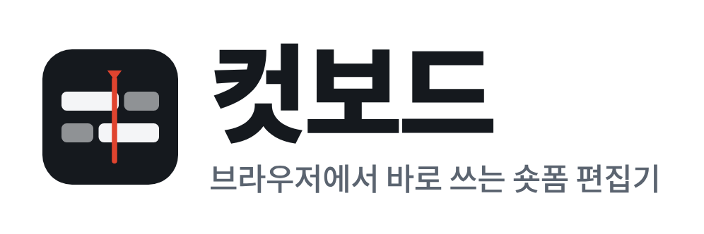
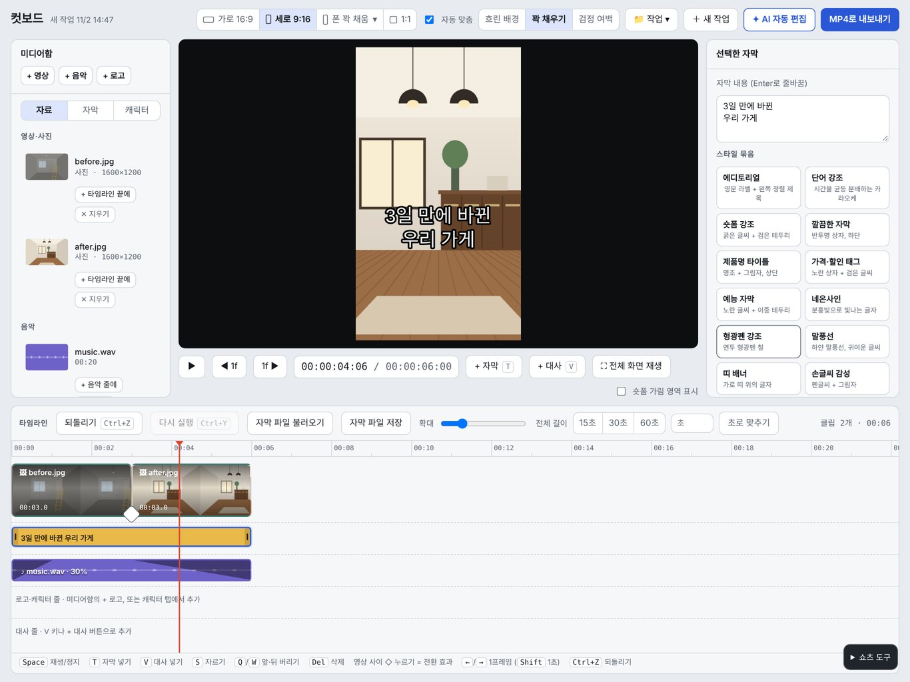
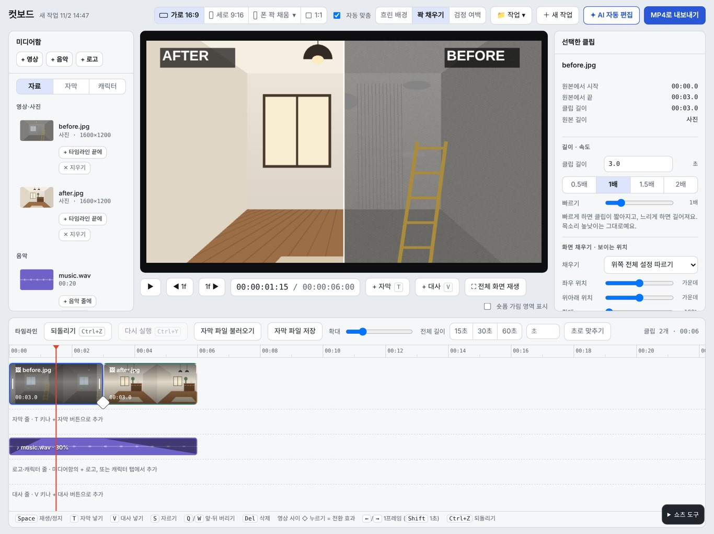
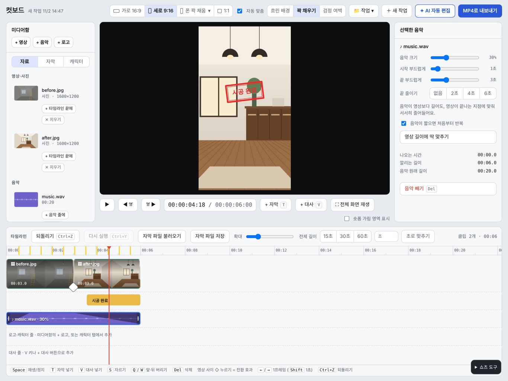

  <picture>
    <source media="(prefers-color-scheme: dark)" srcset="assets/logo-dark.png">
    
  </picture>

  가게 홍보 숏폼을 설치 없이 브라우저에서 만드는 무료 편집기입니다. 
  사진과 영상을 넣고, 자막과 음악을 얹고, MP4로 저장하면 끝입니다.

  <a href="https://gun140985.github.io/cutboard/"><b>컷보드 바로 쓰기</b></a>

 

## 세로 숏폼과 굵은 자막

버튼 하나로 릴스·쇼츠용 세로 화면(9:16)으로 바뀝니다. 굵은 자막, 반투명 박스, 가격·할인 태그 같은 자막 스타일을 골라 바로 입히고, 글자 크기와 위치도 조절할 수 있습니다. 가로(16:9)와 정사각형(1:1)도 지원합니다.

## 비포·애프터를 한 화면에

시공 전 사진과 시공 후 사진을 나란히 놓고 '왼→오 와이프'나 '위/아래 반씩'을 고르면, 가운데 선이 지나가며 바뀌는 장면이 만들어집니다. BEFORE·AFTER 라벨도 자동으로 붙습니다. 인테리어, 청소, 헤어, 네일처럼 결과를 보여줘야 하는 업종에 잘 맞습니다.

## 도장 효과와 음악 박자 맞추기

'시공 완료' 도장, 손그림 동그라미, 체크 표시, 화살표를 영상 위에 찍을 수 있습니다. 배경음악을 넣고 '박자 후보 분석'을 누르면 타임라인 위에 박자 위치가 표시되어, 장면 전환을 음악에 맞추기 쉽습니다. 영상 소리나 대사가 나오는 구간에서는 음악 소리를 자동으로 줄여줍니다.

 

## 이렇게 씁니다

1. [컷보드](https://gun140985.github.io/cutboard/)를 크롬이나 엣지 최신 버전에서 엽니다.
2. `+ 영상`으로 사진·영상을, `+ 음악`으로 배경음악을 넣습니다.
3. 오른쪽 아래 `쇼츠 도구`에서 화면 비율, 자막, 효과를 고릅니다.
4. `MP4로 내보내기`를 눌러 저장합니다.

## 그 밖의 기능

- 자르기, 이어붙이기, 속도 조절, 되돌리기
- 장면 전환 효과와 색보정(따뜻하게, 차분하게, 흑백 등)
- 사진에 천천히 확대·축소되는 움직임 넣기
- 자막 파일(.srt) 불러오기와 저장하기
- 작업 저장과 이어서 하기

## 내 파일은 내 컴퓨터에만

넣은 사진·영상과 작업 기록은 내 브라우저 안에서만 처리되고, 서버로 보내지지 않습니다. (아래 AI 기능을 직접 켰을 때만 해당 서비스로 필요한 내용이 전송됩니다.) 회원가입도 필요 없습니다.

## 안내

- AI 음성(ElevenLabs, Typecast)과 AI 편집(Claude)은 각자 발급한 API 키를 넣어야 쓸 수 있는 선택 기능입니다. 무료 요금제로 만든 AI 음성은 상업적 이용이 제한되거나 출처 표기가 필요하니, 각 서비스의 조건을 확인해 주세요.
- 위 화면의 인테리어 장면은 설명을 위해 그린 예시 이미지입니다.
- 사용된 외부 구성요소의 라이선스는 [THIRD_PARTY_NOTICES.txt](THIRD_PARTY_NOTICES.txt)에 있습니다.

 

© 2026 gun140985. All rights reserved.

